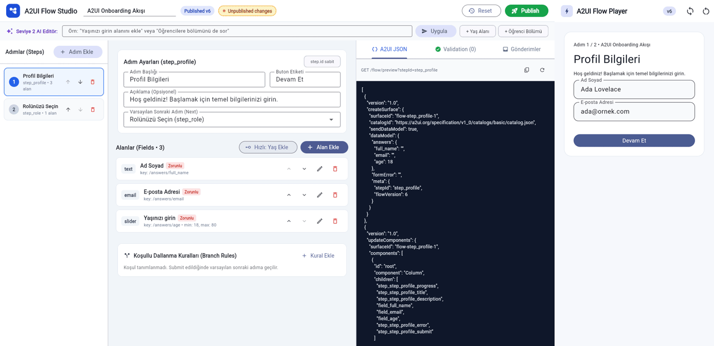

# A2UI Flow Studio

Change a Flutter form without an app store release. Edit an onboarding flow in a web Studio, press **Publish**, and the form on the phone updates live. Whatever the user already typed stays.

The UI protocol is Google's **A2UI (Agent-to-UI) v1.0**, rendered by [`a2ui_flutter`](https://pub.dev/packages/a2ui_flutter). The Player app contains no form code.



*Left: Studio. Right: Player. Publish adds an age slider; name and email are kept.*

> 🇹🇷 Türkçe mimari rehberi: [README.tr.md](README.tr.md)

## How it works

```
Studio (Flutter web)  --REST-->  Server (Dart shelf)  --JSONL + SSE-->  Player (Flutter)
 edits FlowDefinition            compiles to A2UI v1.0                  draws what it receives
```

| Package | Role |
|---|---|
| `apps/studio` | Flutter web editor for the flow, plus an AI prompt box and a Submissions panel |
| `apps/server` | REST for Studio, JSONL stream and SSE for the Player, atomic JSON storage |
| `apps/player` | Flutter app that renders A2UI surfaces; includes a custom `PhotoPicker` component |
| `packages/flow_core` | Domain model, validation, answer reconciliation |
| `packages/flow_compiler` | `FlowDefinition` to A2UI messages |

Key ideas:
- The server is stateless. The phone sends its whole data model with every action.
- Client checks are UX only. The server re-validates every step.
- On Publish, the server notifies the Player over SSE. Answers are reconciled against the new flow, so nothing the user typed is lost.

Full walkthrough: the Medium article (Part 1) and [README.tr.md](README.tr.md).

## Quick start

Requirements: Flutter (Dart SDK ^3.10) and [melos](https://melos.invert.dev).

```bash
dart pub get
melos run serve     # server on http://localhost:8080
melos run studio    # Studio in Chrome on :3000
melos run player    # Player on a simulator or device
```

Open Studio, change the flow, press Publish, and watch the Player.

### Optional: AI editing

Studio has a prompt box ("add an age field"). Without a key it uses a local rule-based engine. To use Gemini:

```bash
GEMINI_API_KEY=your_key melos run serve
```

A human still presses Publish. Edits go through the same validation as manual ones.

## Tests

```bash
melos run analyze
melos run test
```

## Limits

Localhost demo. No auth, submissions are stored in a plain JSON file, and old app versions do not know custom catalog components. Details are in the article.

## License

MIT, see [LICENSE](LICENSE).
