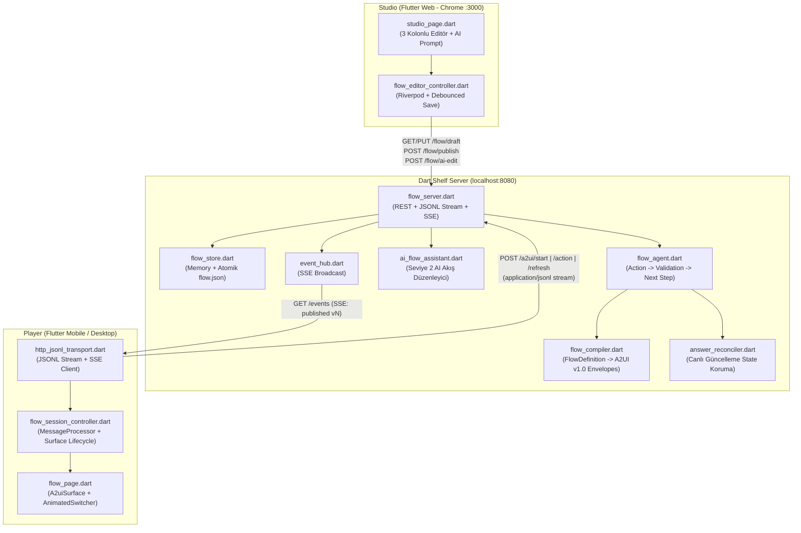

# A2UI Flow Studio — Mimari, A2UI v1.0 Protokolü ve Kod Rehberi

Bu doküman; **A2UI Flow Studio** projesinde ne yaptığımızı, Google'ın **A2UI (Agent-to-UI) v1.0** protokolünün kaputun altında nasıl çalıştığını, kod tabanındaki kritik noktaları (tıklanabilir dosya/satır referanslarıyla) ve canlı sunumda (demo) nasıl kullanılacağını adım adım açıklar.

---

## 1. Projenin Özeti ve Mimari İlkeler

**Tek Cümlelik Özet:**
Local'de çalışan bir Flutter Web panelinden (`apps/studio`) onboarding akışını görsel olarak veya doğal dil komutuyla (AI) düzenliyorsun; Dart sunucusu (`apps/server`) bunu A2UI v1.0 protokol mesajlarına derleyip JSONL stream olarak yayınlıyor; mobil uygulama (`apps/player`) ise içinde hiçbir form/ekran kodu barındırmadan `a2ui_flutter` ile native olarak çiziyor ve **Publish**'e bastığın anda kullanıcının yazdığı verileri kaybetmeden ekranı canlı güncelliyor.

### Temel Mimari İlkelerimiz
1. **Panel ham A2UI düzenlemez:** Studio yalnızca domain modelimiz olan [`FlowDefinition`](packages/flow_core/lib/src/flow_models.dart#L317-L361) nesnesini düzenler. Bunu A2UI protokol zarflarına çevirmek tamamen [`FlowCompiler`](packages/flow_compiler/lib/src/flow_compiler.dart#L17-L448)'ın görevidir.
2. **Server oturum (session) tutmaz:** Kullanıcının formda doldurduğu cevaplar Player'ın kendi A2UI `DataModel`'inde (`/answers/{fieldKey}`) yaşar ve her buton aksiyonunda (`metadata.a2uiRendererDataModel`) sunucuya gönderilir.
3. **İstemciye (Client) güvenilmez:** A2UI bileşenlerindeki `checks` kuralları yalnızca anlık UX (butonu pasif tutma, input altında uyarı gösterme) içindir. Sunucu her `submit_step` aksiyonunda [`FlowValidator.validateStepSubmission`](packages/flow_core/lib/src/flow_validator.dart#L228-L321) ile tüm alanları yeniden doğrular.
4. **Player'da ekran tanımı yoktur:** Player uygulamasında ne "Profil Ekranı" ne de "Rol Seçimi Ekranı" vardır; yalnızca tek bir [`A2uiSurface(surface: surface)`](apps/player/lib/src/ui/flow_page.dart#L183) widget'ı vardır.

---

## 2. A2UI v1.0 Protokolü Nasıl Çalışır? (Koddan Referanslarla)

Google'ın [`a2ui_core: 0.7.0`](apps/player/pubspec.yaml#L14) ve [`a2ui_flutter: 0.3.0`](apps/player/pubspec.yaml#L15) paketleri, sunucu/ajan (Agent) ile istemci (Renderer) arasında **4 temel mesaj zarfı (envelope)** üzerinden haberleşir. Tüm bu zarflar [`A2uiDsl`](packages/flow_compiler/lib/src/a2ui_dsl.dart#L6-L148) sınıfımızda merkezi olarak üretilir:

### 2.1. 4 Temel A2UI Mesaj Zarfı (Server → Player)
Her mesaj `"version": "1.0"` ve **tek bir** işlem anahtarı içerir:

1. **`deleteSurface`** — [`A2uiDsl.deleteSurface`](packages/flow_compiler/lib/src/a2ui_dsl.dart#L101-L106):
   Önceki adıma ait yüzeyi (surface) bellekten ve ekrandan siler.
2. **`createSurface`** — [`A2uiDsl.createSurface`](packages/flow_compiler/lib/src/a2ui_dsl.dart#L109-L122):
   Yeni bir benzersiz yüzey (`flow-{stepId}-{nonce}`) açar, kullanılacak katalog kimliğini (`https://a2ui.org/specification/v1_0/catalogs/basic/catalog.json`), `sendDataModel: true` bayrağını (her aksiyonda client data model'in sunucuya gönderilmesini sağlar) ve başlangıç `dataModel`'ini tanımlar.
3. **`updateComponents`** — [`A2uiDsl.updateComponents`](packages/flow_compiler/lib/src/a2ui_dsl.dart#L125-L134):
   Yüzeydeki bileşen ağacını **düz bir komşuluk listesi (flat adjacency list)** olarak gönderir. İç içe (nested) JSON yerine her bileşenin bir `id`'si vardır ve `root` (`Column`) bileşeni alt bileşenlerine `children: ["step_title", "field_full_name", ...]` şeklinde ID referansı verir.
4. **`updateDataModel`** — [`A2uiDsl.updateDataModel`](packages/flow_compiler/lib/src/a2ui_dsl.dart#L137-L147):
   Yüzeyi yeniden oluşturmadan veri modelindeki tek bir yolu günceller. Örneğin sunucu tarafı doğrulama hatası döndüğünde [`FlowCompiler.compileFormError`](packages/flow_compiler/lib/src/flow_compiler.dart#L268-L277) sadece `/formError` yoluna hata mesajını yazar.

### 2.2. Reaktif Veri Bağlama (`@path`) ve İstemci Fonksiyonları (`@call`)
A2UI v1.0'da dinamik değerler iki özel anahtarla ifade edilir:

* **Veri Bağlama (`{"@path": "/answers/full_name"}`):**
  [`A2uiDsl.path`](packages/flow_compiler/lib/src/a2ui_dsl.dart#L17-L19) ile üretilir. Bir `TextField`, `Slider`, `CheckBox` veya `ChoicePicker` bileşeninin `value` özelliğine `{"@path": "/answers/full_name"}` verdiğimizde, `a2ui_flutter` bunu **iki yönlü (`WritableBinding`)** bağlar. Kullanıcı klavyede her harfe bastığında yüzeyin yerel `DataModel`'indeki `/answers/full_name` otomatik güncellenir.
* **İstemci Tarafı Fonksiyon Çağrısı (`{"@call": "required", "args": ...}`):**
  [`A2uiDsl.call`](packages/flow_compiler/lib/src/a2ui_dsl.dart#L22-L28) ile üretilir. Katalogda yerleşik olan doğrulama fonksiyonları (`required`, `email`, `length`, `numeric`, `and`) sunucuya gitmeden anında Dart tarafında çalışır.

### 2.3. Kaynak Koddan Doğruladığımız Kritik A2UI Detayları
* **Tek Zorunlu Alan ve `and` Kuralı (`minItems: 2`):**
  A2UI v1.0 Basic Catalog şemasında `and` fonksiyonu en az 2 argüman (`minItems: 2`) zorunluluğu koşar. Eğer bir adımda sadece 1 zorunlu alan varsa onu `and` içine sarmak şema hatası fırlatır. [`A2uiDsl.combineConditionsWithAnd`](packages/flow_compiler/lib/src/a2ui_dsl.dart#L89-L97) metodumuz; 0 koşul varsa `null`, 1 koşul varsa doğrudan koşulun kendisini, 2+ koşul varsa `{"@call": "and", "args": {"values": [...]}}` döndürerek bu kenar durumunu çözer.
* **ChoicePicker Her Zaman Liste Döner:**
  `singleChoice` (`mutuallyExclusive`) olsa bile A2UI `ChoicePicker` bileşeni seçili değeri `["developer"]` şeklinde `List<String>` olarak yazar. Hem [`FlowValidator`](packages/flow_core/lib/src/flow_validator.dart#L294-L309) hem de [`AnswerReconciler`](packages/flow_core/lib/src/answer_reconciler.dart#L106-L122) bunu liste olarak işler.
* **Strict vs Relaxed Validation:**
  Derleyicimizin ürettiği tüm mesajlar [`flow_compiler_test.dart`](packages/flow_compiler/test/flow_compiler_test.dart#L8-L14) içinde `MessageProcessor.forAgent` + `ValidationConfig.strict` ile en sıkı şema ve graf kurallarına karşı test edilir. Player tarafında ise stream satır satır gelirken ara durumda sorun yaşanmaması için [`ValidationConfig.relaxed`](apps/player/lib/src/session/flow_session_controller.dart#L89-L94) kullanılır.

---

## 3. Paket Paket Kod Rehberi

### 📦 Paket 1: `packages/flow_core` (Saf Dart Domain & Kurallar)
* **[`flow_models.dart`](packages/flow_core/lib/src/flow_models.dart):**
  * `FieldType` (Satır [6-34](packages/flow_core/lib/src/flow_models.dart#L6-L34)): 9 alan tipini (`text`, `longText`, `email`, `number`, `date`, `singleChoice`, `multiChoice`, `checkbox`, `slider`) tanımlar.
  * `FlowField` (Satır [71-168](packages/flow_core/lib/src/flow_models.dart#L71-L168)): `key` alanı sabittir; etiket (`label`) değişse bile kullanıcının cevabı `key` üzerinden taşınır.
  * `BranchRule` & `StepNext` (Satır [171-249](packages/flow_core/lib/src/flow_models.dart#L171-L249)): Koşullu adım geçişlerini (`fieldKey == equals -> goToStepId`) modeller.
  * `FlowSnapshot` (Satır [364-414](packages/flow_core/lib/src/flow_models.dart#L364-L414)): `draft`, `published`, `publishedVersion` ve `hasUnpublishedChanges` (`draft != published`) durumunu tutar.
* **[`flow_validator.dart`](packages/flow_core/lib/src/flow_validator.dart):**
  * `validateFlow` (Satır [29-223](packages/flow_core/lib/src/flow_validator.dart#L29-L223)): Publish öncesi benzersiz ID/key kontrolü, seçim alanlarında en az 2 seçenek kontrolü, slider min/max kontrolü ve **DFS ile adım döngüsü (cycle)** tespitini yapar.
  * `validateStepSubmission` (Satır [228-321](packages/flow_core/lib/src/flow_validator.dart#L228-L321)): Server'a gelen kullanıcı cevaplarını doğrular.
* **[`answer_reconciler.dart`](packages/flow_core/lib/src/answer_reconciler.dart):**
  * `AnswerReconciler.reconcile` (Satır [37-87](packages/flow_core/lib/src/answer_reconciler.dart#L37-L87)): Canlı güncelleme geldiğinde çalışan saf fonksiyon. Yeni alan eklendiyse mevcut cevapları korur, silinen alanı atar, tipi uyumsuz değişen alanı temizler, silinen choice seçeneğini listeden çıkarır, bulunulan adım silindiyse ilk adıma döner.

### 📦 Paket 2: `packages/flow_compiler` (FlowDefinition → A2UI Derleyici)
* **[`flow_compiler.dart`](packages/flow_compiler/lib/src/flow_compiler.dart):**
  * `compileStep` (Satır [32-177](packages/flow_compiler/lib/src/flow_compiler.dart#L32-L177)): Bir `FlowStep`'i alır; başlık, açıklama, alanlar (`field_{key}`), `/formError` metni ve `submit_step` aksiyonlu butonu içeren A2UI bileşen ağacını üretir.
  * `compileSummary` (Satır [180-265](packages/flow_compiler/lib/src/flow_compiler.dart#L180-L265)): Sonraki adım `null` olduğunda tüm cevapların özetini ve `restart` butonunu içeren bitiş ekranını üretir.
  * `_compileField` (Satır [291-447](packages/flow_compiler/lib/src/flow_compiler.dart#L291-L447)): 9 `FieldType`'ın her birini karşılık gelen A2UI bileşenine ve `checks` kurallarına dönüştürür.

### 🖥️ Uygulama 1: `apps/server` (Dart Shelf Sunucusu)
* **[`flow_server.dart`](apps/server/lib/src/flow_server.dart):**
  * `_streamJsonlMessages` (Satır [241-262](apps/server/lib/src/flow_server.dart#L241-L262)): Mesajlar arasına `120ms` gecikme koyarak `application/jsonl` olarak stream eder. `shelf.io.buffer_output: false` ayarıyla her satırın anında istemciye ulaşmasını (progressive rendering) garanti eder.
  * `_handleEvents` (Satır [63-80](apps/server/lib/src/flow_server.dart#L63-L80)): SSE (`/events`) bağlantısını açar ve Publish anında [`EventHub.broadcastPublished`](apps/server/lib/src/event_hub.dart#L47-L68) ile bağlı tüm telefonlara yeni versiyonu bildirir.
* **[`flow_agent.dart`](apps/server/lib/src/flow_agent.dart):**
  * `handleAction` (Satır [50-169](apps/server/lib/src/flow_agent.dart#L50-L169)): İstemciden gelen `submit_step` veya `restart` aksiyonunu işler. Eğer istemcinin `flowVersion`'ı eskiyse aksiyonu işlemek yerine otomatik olarak `refresh` davranışına düşer (Satır [99-107](apps/server/lib/src/flow_agent.dart#L99-L107)).
* **[`ai_flow_assistant.dart`](apps/server/lib/src/ai_flow_assistant.dart):**
  * `applyPrompt` (Satır [38-62](apps/server/lib/src/ai_flow_assistant.dart#L38-L62)): Faz 6 (Seviye 2 Generative UI — Yol A). Ortamda `GEMINI_API_KEY` varsa Gemini 2.5 Flash ile, yoksa deterministik yerel niyet motoruyla doğal dil komutunu (`"Öğrencilere bölümünü de sor"`, `"Yaş alanı ekle"`) `FlowDefinition` güncellemesine çevirir.

### 📱 Uygulama 2: `apps/player` (Flutter Mobil / Desktop Renderer)
* **[`http_jsonl_transport.dart`](apps/player/lib/src/transport/http_jsonl_transport.dart):**
  * `_postJsonl` (Satır [72-146](apps/player/lib/src/transport/http_jsonl_transport.dart#L72-L146)): Chunked HTTP yanıtını `LineSplitter` ile satır satır okur ve her JSONL satırını anında `Stream` üzerinden yayınlar.
  * `events` (Satır [149-206](apps/player/lib/src/transport/http_jsonl_transport.dart#L149-L206)): SSE dinleyicisidir. Bağlantı koptuğunda otomatik yeniden bağlanır; bağlandığı anda sunucunun gönderdiği mevcut versiyonu kontrol eder.
* **[`flow_session_controller.dart`](apps/player/lib/src/session/flow_session_controller.dart):**
  * `MessageProcessor` kurulumu (Satır [89-119](apps/player/lib/src/session/flow_session_controller.dart#L89-L119)): `basicCatalog()` ile işlemciyi başlatır, `onSurfaceCreated`, `onSurfaceDeleted` ve `onAction` olaylarını dinler.
  * `refreshCurrentStep` (Satır [149-203](apps/player/lib/src/session/flow_session_controller.dart#L149-L203)): SSE'den yeni `version` geldiğinde mevcut yüzeyin `dataModel`'ini (`_processor.getRendererDataModel`) alıp `/a2ui/refresh` çağrısı yapar ve `"updated to vN"` banner'ını tetikler.

### 🌐 Uygulama 3: `apps/studio` (Flutter Web Editörü)
* **[`flow_editor_controller.dart`](apps/studio/lib/src/editor/flow_editor_controller.dart):**
  * `_applyDraftMutation` (Satır [257-266](apps/studio/lib/src/editor/flow_editor_controller.dart#L257-L266)): Yapılan her değişikliği `350ms` debounce ile otomatik olarak `PUT /flow/draft`'a kaydeder ve sağ kolondaki A2UI JSON önizlemesini (`GET /flow/preview`) yeniler.
* **[`studio_page.dart`](apps/studio/lib/src/ui/studio_page.dart):**
  * 3 kolonlu Studio arayüzü: Sol kolon (`_StepListColumn`), Orta kolon (`_StepEditorColumn`), Sağ kolon (`_InspectorColumn` — A2UI JSON ve Validation sekmeleri) ve üstteki Seviye 2 AI Editör çubuğu.

---

## 4. VS Code / Antigravity Üzerinden Tek Tıkla Çalıştırma

[`.vscode/launch.json`](.vscode/launch.json) içinde tüm başlatma profilleri hazırdır:

1. Sol menüden **Run and Debug (`Cmd + Shift + D`)** panelini aç.
2. En üstteki açılır menüden şunlardan birini seçip **Yeşil Play (`F5`)** tuşuna bas:
   * **`🚀 Full Demo (Server + Studio Web + Player iOS)`**: Sunucuyu (`8080`), Chrome'da Studio'yu (`3000`) ve açık olan iOS Simulator'da Player'ı aynı anda başlatır.
   * **`💻 Desktop Demo (Server + Studio Web + Player macOS)`**: Simülatör açmadan Player'ı macOS masaüstü uygulaması olarak, Studio'yu Chrome'da ve Server'ı arka planda aynı anda başlatır.

---

## 5. Canlı Yayın / Demo Akışı (Adım Adım Senaryo)

1. **Başlangıç:** Sistem açıldığında Player'da **Adım 1 / 2 • Profil Bilgileri** görünür. Alanlar boşken **Devam Et** butonu pasiftir (A2UI client-side `checks`).
2. **Veri Girişi:** Player'da Ad Soyad alanına `Ada Lovelace`, E-posta alanına `ada@ornek.com` yaz (henüz Devam Et'e basma).
3. **Yayındaki Ana An (Canlı Güncelleme):**
   * Studio'da (Chrome) orta kolondaki **`Hızlı: Yaş Ekle`** butonuna (veya üstteki AI çubuğunda **`+ Yaş Alanı`** çipine) tıkla.
   * Sağdaki **A2UI JSON** sekmesinde `field_age` (`Slider`) bileşeninin üretildiğini göster.
   * Sağ üstteki yeşil **`Publish`** butonuna bas.
   * **Player'da:** Üstte `"Canlı güncelleme alındı: updated to v2"` banner'ı belirir; `Ada Lovelace` ve `ada@ornek.com` silinmeden yerinde dururken altlarına **"Yaşınızı girin"** Slider'ı eklenir!
4. **Seviye 2 AI & Dallanma (Branching):**
   * Studio'da üstteki AI çubuğundan **`+ Öğrenci Bölümü`** çipine tıkla (veya `"Öğrencilere bölümünü de sor"` yazıp Uygula'ya bas) ve **`Publish`** de.
   * Player'da **Devam Et**'e basıp 2. adıma geç. Rol olarak **"Öğrenci / Araştırmacı"** seçip devam ettiğinde otomatik olarak yeni oluşturulan 3. adıma (**Eğitim & Bölüm Bilgileri**) dallandığını göster!
